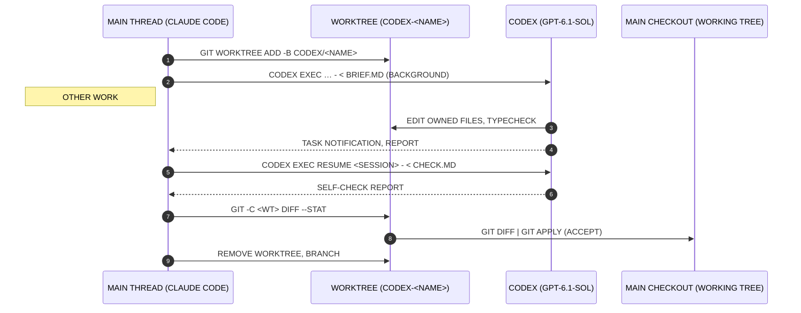
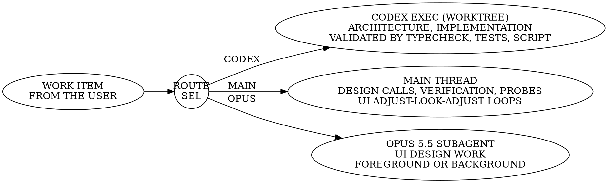

## Introduction

The Codex delegation subsystem (CDS) hands implementation work from the Claude Code main thread to Codex while the main thread keeps working. Each job runs in its own git worktree on its own branch, so its work comes back as one clean diff that the main thread reviews and then accepts or abandons (figure 2.3-1).

```dot {caption="Codex Delegation Subsystem, Functional Block Diagram" code="CDX-501A"}
digraph cds {
  rankdir=LR; splines=ortho; nodesep=0.35; ranksep=0.45;
  subgraph cluster_main { label="MAIN THREAD\nCLAUDE CODE"; labeljust=l; style=solid; penwidth=0.6;
    cache [shape=cylinder, label="QUOTA CACHE\n5H %, 7D %"];
    gate  [label="QUOTA GATE\n5H < 85 % USED\n7D < 90 % USED"];
    brief [label="BRIEF\nSELF-CONTAINED\nOWNED FILES ONLY"];
  }
  subgraph cluster_wt { label="GIT WORKTREES · .CLAUDE/WORKTREES/"; labeljust=l; style=dashed; penwidth=0.6;
    jobA [label="CODEX EXEC · JOB A\nBRANCH CODEX/<NAME-A>\nSANDBOX WORKSPACE-WRITE\nREPORT TO -O <OUT>"];
    jobB [label="CODEX EXEC · JOB B\nBRANCH CODEX/<NAME-B>\nSANDBOX WORKSPACE-WRITE\nREPORT TO -O <OUT>"];
  }
  review [label="REVIEW\nSELF-CHECK RESUME\nDIFF --STAT, TYPECHECK"];
  accept [label="ACCEPT\nGIT DIFF | GIT APPLY"];
  abandon [shape=plaintext, label="ABANDON:\nREMOVE WORKTREE\nAND BRANCH"];
  main [shape=cylinder, label="MAIN\nCHECKOUT"];
  cache -> gate [xlabel="READ"];
  gate -> brief [xlabel="OPEN"];
  brief -> jobA [xlabel="STDIN"];
  brief -> jobB;
  jobA -> review [xlabel="DIFF"];
  jobB -> review;
  review -> accept [xlabel="PASS"];
  review -> abandon;
  accept -> main;
}
```

## Functional Description

The main thread reads the quota cache that the status line keeps. With the quota gate open, it writes a self-contained brief, adds a worktree on a new codex/<name> branch and starts codex exec in the background. It keeps working until the task notification arrives, resumes the Codex session with a self-check, then reviews the diff and re-runs the typecheck (figure 2.3-2).

### Quota Gate

Codex is available while the 5-hour window is under 85 % used and the 7-day window under 90 %. A window whose reset time has passed counts as 0 % used.

### Worktree Base

The worktree branches from HEAD. A job that builds on uncommitted work branches from the sha that git stash create prints, with any untracked files it needs copied in.

::: figure Quota Gate Envelope and Cache Record {code=CDX-502A}
```vega-lite
{
  "width": 300, "height": 210,
  "layer": [
    {
      "data": {"values": [{"x": 0, "x2": 85, "y": 0, "y2": 90}]},
      "mark": {"type": "rect", "fill": "none", "stroke": "#000", "strokeWidth": 1.2},
      "encoding": {
        "x": {"field": "x", "type": "quantitative", "scale": {"domain": [0, 100]}, "title": "5-HOUR WINDOW, % USED"},
        "x2": {"field": "x2"},
        "y": {"field": "y", "type": "quantitative", "scale": {"domain": [0, 100]}, "title": "7-DAY WINDOW, % USED"},
        "y2": {"field": "y2"}
      }
    },
    {
      "data": {"values": [{"x": 85}]},
      "mark": {"type": "rule", "strokeDash": [4, 2], "strokeWidth": 0.8},
      "encoding": {"x": {"field": "x", "type": "quantitative"}}
    },
    {
      "data": {"values": [{"y": 90}]},
      "mark": {"type": "rule", "strokeDash": [4, 2], "strokeWidth": 0.8},
      "encoding": {"y": {"field": "y", "type": "quantitative"}}
    },
    {
      "data": {"values": [
        {"x": 34, "y": 70, "t": "AVAILABLE"},
        {"x": 88, "y": 50, "t": "HOLD"},
        {"x": 64, "y": 4, "t": "5H LIMIT 85 %"},
        {"x": 3, "y": 85, "t": "7D LIMIT 90 %"}
      ]},
      "mark": {"type": "text", "fontSize": 9, "align": "left"},
      "encoding": {
        "x": {"field": "x", "type": "quantitative"},
        "y": {"field": "y", "type": "quantitative"},
        "text": {"field": "t"}
      }
    },
    {
      "data": {"values": [{"x": 40, "y": 41}]},
      "mark": {"type": "point", "shape": "circle", "filled": true, "size": 40},
      "encoding": {"x": {"field": "x", "type": "quantitative"}, "y": {"field": "y", "type": "quantitative"}}
    },
    {
      "data": {"values": [{"x": 42, "y": 37, "t": "READING 1 NOV 2026"}, {"x": 42, "y": 31, "t": "5H 40 %, 7D 41 %"}]},
      "mark": {"type": "text", "align": "left", "fontSize": 8.5},
      "encoding": {"x": {"field": "x", "type": "quantitative"}, "y": {"field": "y", "type": "quantitative"}, "text": {"field": "t"}}
    }
  ]
}
```
::: detail DETAIL A: QUOTA CACHE RECORD
/TMP/CLAUDE-STATUSLINE-CODEX, ONE LINE

| 5H USED % | 5H RESET | 7D USED % | 7D RESET |
|---|---|---|---|
| 40 | 1793520991 | 41 | 1793868108 |

FIELDS TAB-SEPARATED; RESETS IN UNIX EPOCH SEC.

1. RESET PASSED: WINDOW READS 0 %
2. FILE STALE OR MISSING: DISPATCH ANYWAY
3. QUOTA ERROR RETURNED: ROUTE ELSEWHERE
:::
:::

::: cols 1fr 64mm
::: col
## Design Data

Table: CDS Design Data

| Parameter | Value |
|---|---|
| Model | gpt-6.1-sol |
| Reasoning effort | low (medium for harder jobs) |
| Sandbox | workspace-write |
| Dispatch limit, 5-hour window | under 85 % used |
| Dispatch limit, 7-day window | under 90 % used |
| Worktree | .claude/worktrees/codex-<name> |
| Branch | codex/<name> |
| Launch | Bash run_in_background |
:::
::: col
::: caution
Concurrent jobs see each other's half-edits and may report "blocked" when they are not. Re-run the typecheck before accepting.
:::

```checklist DISPATCH JOB | MAIN
1 QUOTA CACHE - read, gate open
2 WORKTREE - add, codex/<name>
3 BRIEF - write, files owned
4 CODEX EXEC - start, bkgd
  √ JOB tb - bp
5 MAIN THREAD - continue work
  √ JOB tb - gray
```
:::
:::

## Job Sequence

A job runs in nine steps (figure 2.3-3). The main thread owns the brief, the acceptance probes and the final review; Codex changes code only inside its worktree. Between steps 2 and 4 the main thread does other work and does not poll.



## Work Routing

Work is routed by how it is checked. Architecture and implementation that a typecheck, test or script can validate go to Codex. UI design and any adjust, look, adjust loop stay on the main thread or go to an Opus 5.5 subagent. Design calls, verification and judgment across jobs never leave the main thread (figure 2.3-4).

### Shared Pieces

Library code that several jobs call is written on the main thread first; Codex receives only the callers.

### Parallel Jobs

Several jobs may run at once on disjoint files. Each is reviewed alone with git -C <worktree> diff --stat, and its worktree and branch are removed once it is accepted or abandoned.

::: figure Work Routing Selector and Brief Contents {code=CDX-504A}

::: detail DETAIL A: BRIEF CONTENTS
1. SELF-CONTAINED; NO SHARED CONTEXT
2. "EDIT ONLY THESE FILES"
3. WHERE NEW CODE GOES
4. EXAMPLES TO COPY, FILE:LINE
5. BEHAVIOURS TO KEEP, NUMBERED
6. HAZARDS NAMED UP FRONT
7. NO COMMITS, RESTARTS, PROBES, BROWSERS OR STASH
8. GREP FOR EVERY REMOVED NAME
9. END: TYPECHECK, SHORT REPORT
:::
:::

::: cols 1fr 64mm
::: col
## Self-Check Failure Modes

Table: Codex Weak Spots Named in Every check.md

| Failure mode | Look for |
|---|---|
| Misses outside references | importers of deleted files |
| Subtle semantics | a control inside a label |
| Small unasked edits | files in diff --stat |
| False unification | merged things that differ |
| Changed fallback | a default's new meaning |
| Rules in code, not data | data files left stale |
| Leftover raw markup | markup it wasn't told about |
| Overrides, not retargets | new rules undoing old |
:::
::: col
::: note
Acceptance probes and tests belong to the main thread. They are written and frozen first, then handed over read-only.
:::

```checklist ACCEPT JOB | MAIN
1 RESUME - check.md, self-check
2 DIFF --STAT - no unasked edits
3 TYPECHECK - rerun
  √ PROBES - pass
4 GIT APPLY - main checkout
5 WORKTREE, BRANCH - remove
```
:::
:::
